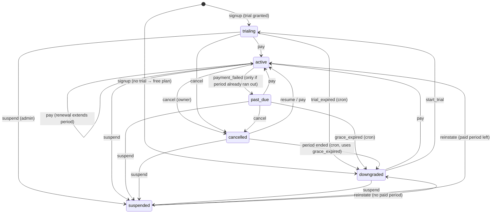
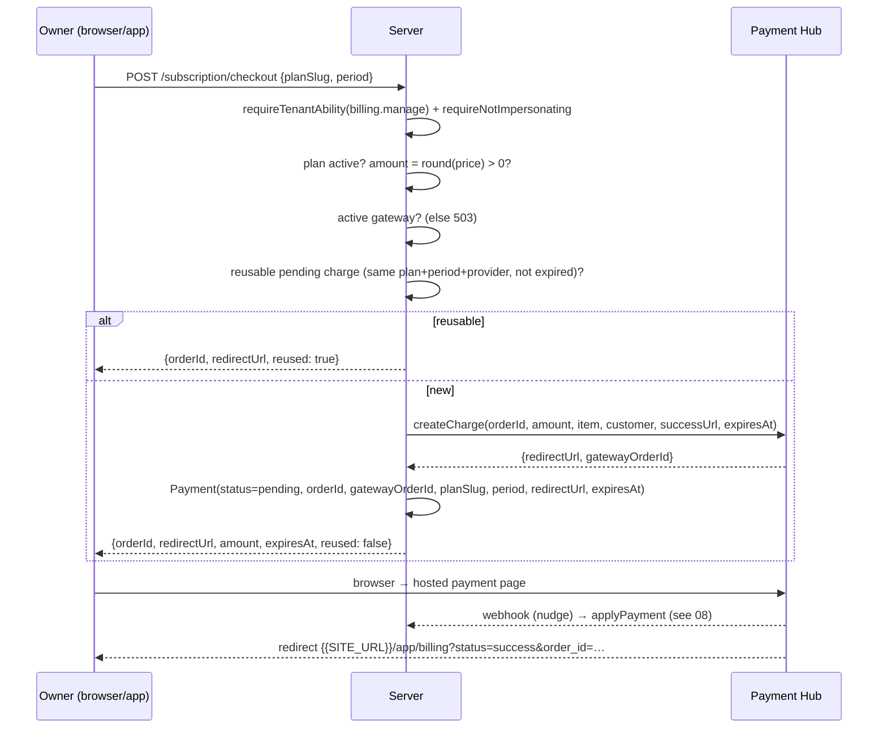

# 07 — Subscription Lifecycle & Billing Flows

## 1. State machine



**`downgraded` means "on the free/default plan" (`free` = 10 employees, 1
office, 1 team login per D4).** It is not "no access". The subscription belongs
to the Tenant (company) and is paid by the owner; employees never pay (D2).
Example plan slugs in this file: `free`, `growth`, `business`, `enterprise`;
trial plan proposed `business` (14 days).

### 1.1 One writer (MUST)

All transitions go through `transitionSubscription()` in
`server/utils/subscriptions.ts`. **Nothing else may write
`Subscription.status`** — the only exceptions are signup (creates the row) and
the audited superadmin override; both also write a `SubscriptionEvent`.

```ts
export type SubscriptionTransition =
  | 'start_trial' | 'pay' | 'payment_failed' | 'grace_expired' | 'trial_expired'
  | 'cancel' | 'resume' | 'suspend' | 'reinstate'

const ALLOWED: Record<SubscriptionTransition, SubscriptionStatus[]> = {
  start_trial:    ['downgraded', 'cancelled'],
  pay:            ['trialing', 'active', 'past_due', 'cancelled', 'downgraded'],
  payment_failed: ['active', 'trialing', 'past_due'],
  grace_expired:  ['past_due'],
  trial_expired:  ['trialing'],
  cancel:         ['trialing', 'active', 'past_due'],
  resume:         ['cancelled'],
  suspend:        ['trialing', 'active', 'past_due', 'cancelled', 'downgraded'],
  reinstate:      ['suspended']
}

export interface TransitionInput {
  tenantId: string
  transition: SubscriptionTransition
  planSlug?: string                 // pay / start_trial
  period?: 'monthly' | 'yearly'
  reason?: string
  force?: boolean                   // skip ALLOWED guard (system jobs, webhook, admin)
  tx?: Prisma.TransactionClient     // run inside the caller's transaction
}
```

What each transition writes:

| Transition | Writes |
|---|---|
| `start_trial` | plan = `planSlug` or setting `billing.trialPlanSlug`; `status=trialing`; `trialEndsAt = now + plan.trialDays`; clear grace/downgraded/cancelled |
| `pay` | plan = `planSlug` (or current); `period`; `status=active`; `currentPeriodEnd = periodEnd(max(now, currentPeriodEnd), period)` (**renewing early stacks onto the remaining time**); clear grace/trial/cancelled/downgraded |
| `payment_failed` | `status=past_due`; `graceEndsAt = now + billing.gracePeriodDays` |
| `trial_expired`, `grace_expired` | plan = setting `billing.defaultPlanSlug` (`free`); `status=downgraded`; `downgradedAt=now`; clear grace/trial/currentPeriodEnd; **then `enforceBranchLimit()`** (outside any tx; HRIS also runs `enforceEmployeeLimit()` / team-seat enforcement, see §6) |
| `cancel` | `status=cancelled`; `cancelledAt=now` (keeps `currentPeriodEnd` — runs to the end) |
| `resume` | `active` if paid period remains, else `trialing`; clear `cancelledAt` |
| `suspend` | `status=suspended` |
| `reinstate` | `active` if `currentPeriodEnd > now`, else `downgraded` |

After the update, **in the same client** (`tx` if given):

```ts
await db.subscriptionEvent.create({ data: {
  tenantId, transition, fromStatus, toStatus, fromPlanSlug, toPlanSlug, period
}})
invalidateEntitlements(tenantId)
```

Illegal transition without `force` → 409 `CONFLICT`
`{ from, transition }`. Missing subscription → 404. Missing plan → 404.

`periodEnd(from, period)` = `addMonths(from, 1 | 12)` in UTC.

### 1.2 Is the subscription actually due?

A renewal on a hub without recurring billing is a **checkout the owner starts
by hand**. An owner who opens the payment page two weeks early and abandons it
produces an `expired` charge identical to a genuine default. So a failed or
expired charge only enters grace when the paid time has actually run out:

```ts
export function isSubscriptionDue(s, now = new Date()): boolean {
  switch (s.status) {
    case 'trialing': return !s.trialEndsAt || s.trialEndsAt <= now
    case 'active':   return !s.currentPeriodEnd || s.currentPeriodEnd <= now
    case 'past_due': return true
    default:         return false
  }
}
```

## 2. Subscription history — `SubscriptionEvent`

Append-only, written by `transitionSubscription`, signup (`'signup'`) and the
admin override (`'admin_override'`). The back-office report derives:

- **new paid** = a `pay` whose `fromStatus` is non-paying (`trialing`,
  `downgraded`, …);
- **renewal** = a `pay` from a paying status;
- **churn** = a move to `downgraded` from a paying status.

**Any new code path that writes `Subscription` must write an event too**, or
it is invisible to revenue reporting.

## 3. Checkout — `startCheckout(event, { planSlug, period })` (`server/utils/checkout.ts`)

Endpoints: `POST /api/app/subscription/checkout`,
`POST /api/v1/subscription/checkout`.



Details:

1. Gate: `requireTenantAbility('billing.manage')` then
   `requireNotImpersonating()`.
2. Plan must exist and be `isActive` → else 404.
3. `amount = Math.round(Number(period === 'yearly' ? priceYearly : priceMonthly))`;
   `amount <= 0` → 400 "this plan is free".
4. `requireActiveGateway(await getActiveGateway())` → 503 if none.
5. **Idempotency — the same plan asked twice is one charge.** Find a payment
   with `status ∈ {pending, challenge}`, same `planSlug`, `period`,
   `provider`, `redirectUrl` not null, and (`expiresAt` null or in the future).
   If found, return it with `reused: true`.
6. Otherwise `orderId = generateOrderId()` →
   `{{LOCAL_ORDER_PREFIX}}-<Date.now() base36 upper>-<4 random base36 upper>`;
   `expiresAt = now + 60 min`.
7. `driver.createCharge(creds, { orderId, amount, currency, itemName:
   '{{APP_NAME}} <Plan> — Bulanan|Tahunan', customer: { name, email, phone },
   successUrl: '{{SITE_URL}}/app/billing?status=success&order_id=' + orderId,
   failureUrl: '…status=failed…', expiresAt, metadata: { tenantId, planSlug, period } })`.
8. Create `Payment` with `gatewayOrderId` from the driver (the id the gateway
   will use in callbacks), `status: 'pending'`, `raw`.
9. Return `{ orderId, redirectUrl, token?, clientKey?, amount, expiresAt, reused: false }`.

### 3.1 Replacing an unfinished charge — `cancelTenantPayment(event, paymentId)`

`POST /api/app/subscription/payments/:id/cancel` (+ v1). Stops one month being
paid twice when the owner switches plan mid-checkout.

1. `billing.manage` + not impersonating; payment must belong to the tenant
   (404).
2. Status must be `pending` or `challenge` → else 409 "already processed".
3. If the provider's credentials still exist: `driver.cancelCharge(creds,
   orderId)` → `applyPayment(result)` (**the gateway decides** — a charge paid
   seconds ago comes back `paid` and stays paid). Hub answers 409 for a settled
   charge → surfaced to the client, which stops.
4. If the gateway has since been removed: mark the row `cancelled` locally
   (`rawStatus: 'cancelled_locally'`).
5. Audit `payment.cancel`. Return `{ success, orderId, status: 'cancelled', alreadyCancelled }`.

### 3.2 Client billing page behaviour (`/app/billing`)

- Data: `GET /api/app/subscription` →
  `{ subscription(+plan), entitlements, plans (active+public), pendingPayments,
  needsBranchSelection, checkoutAvailable }`. The gateway name/credentials are
  **never** returned — only `checkoutAvailable`.
- History: `GET /api/app/subscription/payments?page&limit` (paged; the pending
  list above is complete, not paged — a charge on page 2 is exactly the one
  that gets paid twice).
- Monthly/yearly toggle; plan cards; current plan + status badge; trial days
  left; grace notice ("if payment hasn't arrived by D, plan drops to Free; data
  is kept").
- "Awaiting payment" = status `pending|challenge` **and** not past `expiresAt`.
- On choose plan: if unfinished charges exist other than the exact match for
  this plan+period → confirm "replace unfinished payment?" → cancel each (stop
  on first error) → checkout → `window.location.href = redirectUrl`. Toast
  "continuing previous payment" when `reused`.
- Return from gateway (`?status=…&order_id=…` or `&reference=…`): strip the
  query (so reload doesn't repeat), **read the payment's own status from the
  API** (the URL door is not proof of payment), retry once after ~2.5 s if
  still pending, then toast accordingly and refresh entitlements.
- Buttons disabled while impersonating or when `checkoutAvailable` is false.
- Cancel subscription: confirm ("stays active until period end, then Free
  (maks. 10 karyawan aktif); data karyawan, absensi, dan slip gaji tetap tersimpan") → `POST /api/app/subscription/cancel`.

## 4. Applying a payment result — `applyPayment(normalized)`

`server/utils/payment-apply.ts`. Called by the webhook receiver, the admin
replay, the reconciler and `cancelTenantPayment`. Idempotent.

```
payment = find by normalized.orderId (OUR order id)      → none: { applied:false, reason:'unknown order' }
payment.status === normalized.status                       → { applied:false, noop:true }
payment.status === 'paid' && normalized.status !== 'refunded' → noop (terminal)

paymentData = { status, rawStatus, paymentType, paidAt (or now if paid), raw }

status === 'paid':
  $transaction(tx):                       ← ONE FACT: row paid + subscription activated
    tx.payment.update(paymentData)
    transitionSubscription({ tenantId, transition:'pay', planSlug: payment.planSlug,
                             period: payment.period, force:true, tx })
  then (outside tx): notification 'payment_success' to owner
       { amount (formatted), planName, periodLabel, orderId, periodEnd, tenantName, billingUrl }
  → { applied:true }

status ∈ {failed, expired}:
  entersGrace = $transaction(tx):
    tx.payment.update(paymentData)
    sub = tx.subscription.find
    enters = sub && sub.status ∈ {active, trialing, past_due} && isSubscriptionDue(sub)
    if enters: transitionSubscription({ transition:'payment_failed', force:true, tx })
  if entersGrace: notification 'payment_failed' { amount, planName, tenantName, graceEndsAt, billingUrl }
  → { applied:true }

otherwise (pending, challenge, cancelled, refunded):
  payment.update(paymentData) → { applied:true }
```

Why one transaction for `paid`: if the row became `paid` and the subscription
activation then failed (e.g. the plan slug was renamed), every recovery path
would see "already paid" and do nothing — the customer is charged and left on
no plan. Rolling both back keeps the row `pending`, so the next webhook retry,
the reconciler or a replay completes it. **Notifications stay outside** the
transaction: an email must never roll back a payment, and a transaction must
never be held open across the network.

Only the tenant is notified of a successful payment; the back-office record is
`/admin/payments`.

## 5. Cancel subscription — `cancelSubscription(event)`

`POST /api/app/subscription/cancel`, `POST /api/v1/subscription/cancel`.

1. `billing.manage` + not impersonating.
2. If the subscription has a gateway mandate (`providerRef`) and the driver
   supports it, call `driver.cancelSubscription` — failure is logged, never
   blocks the local transition.
3. `transitionSubscription({ transition: 'cancel' })` → runs to
   `currentPeriodEnd`, the daily cron then downgrades.
4. Audit `subscription.downgrade` `{ cancelledBy: 'owner' }`.

## 6. Downgrade enforcement — `enforceBranchLimit(tenantId)`

Called after `trial_expired` / `grace_expired` and after an admin override.

1. Read the current plan's `branches` limit; unlimited → nothing.
2. Active branches ordered `isPrimary desc, createdAt asc`; keep the first
   `max`.
3. **One transaction**: deactivate the rest **and** set
   `Tenant.downgradeResolvedAt = null` (the flag that triggers the "choose"
   dialog must land with the deactivation it asks about).
4. Notify owner `subscription_downgraded` with
   `branchSelectionUrl = {{SITE_URL}}/app/branches` (email + bell).

HRIS adds sibling enforcers with the same shape (same transaction rule, same
`downgradeResolvedAt` flag, same owner notification), run right after
`enforceBranchLimit`:

- `enforceEmployeeLimit(tenantId)` — keeps the oldest-hired active employees up
  to the `employees` limit; the rest become `inactive_over_limit` and their ESS
  memberships are deactivated. **Never deletes** employees, attendance, leave,
  payroll or payslips (history and issued payslips stay readable by HR); HR gets
  a "choose which employees stay active" dialog.
- `enforceTeamSeatLimit(tenantId)` — deactivates newest owner-excluded
  `hr_admin`/`manager` logins over `teamMembers`; employee logins are unaffected.

`needsBranchSelection(tenantId)` = `downgradeResolvedAt` is null **and** total
branches > limit. Exposed on the profile and subscription endpoints; the
console shows a blocking dialog on the branches page.

`selectActiveBranches(event, { branchIds })` (`branches.manage`):
(HR equivalents: `selectActiveEmployees` with `employees.write` + `employees`
limit.) Count ≤ limit (else 402), all ids belong to the tenant (else 404); one
transaction: activate chosen, deactivate others, set `downgradeResolvedAt=now`.

## 7. Renewal model

The Payment Hub has **no recurring API**. Therefore:

- Only the company → platform subscription goes through the hub; salary
  payments are never processed here (D5).
- Cron jobs (`trial_expired`, `grace_expired`, reminders) are Vercel Cron `GET
  /api/cron/*` endpoints: idempotent, throttled, safe to run twice.
- A renewal is **a fresh checkout** the owner starts from `/app/billing`
  (reminded by notifications). `pay` extends from the later of now and the
  current period end, so paying early never loses days.
- `createSubscription` in the hub driver throws 501; `cancelSubscription` is a
  no-op. Do not build a saved-card flow in the platform.
- If a future driver supports mandates, store `providerRef` + `provider` on
  `Subscription`; the cancel path already calls it.

## 8. Notifications fired by billing

| Event | Template key | Channels |
|---|---|---|
| Signup with trial | `trial_started` | bell (+push) |
| Trial ends within `billing.trialReminderDays` | `trial_ending_soon` (once/day) | bell + email (+push) |
| Payment paid | `payment_success` | bell + email (+push) |
| Payment failed/expired while due | `payment_failed` | bell + email (+push) |
| Downgrade enforced (offices / employees / team seats over cap) | `subscription_downgraded` | bell + email (+push) |
| Tenant suspended / deleted | `tenant_suspended` / `tenant_deleted` | bell + email |

## 9. Admin views

- `/admin/subscriptions` — list with filters (status, plan, search), trial and
  period end dates.
- `/admin/payments` — every payment, status, amount, provider, tenant, order
  ids (ours + gateway's), raw status.
- `/admin/tenants/:id` — subscription card with the **plan override** form
  (plan, period, status, optional period end, note).
- `/admin/webhook-events` — callback log + replay. See `08-payment-gateway.md`.
